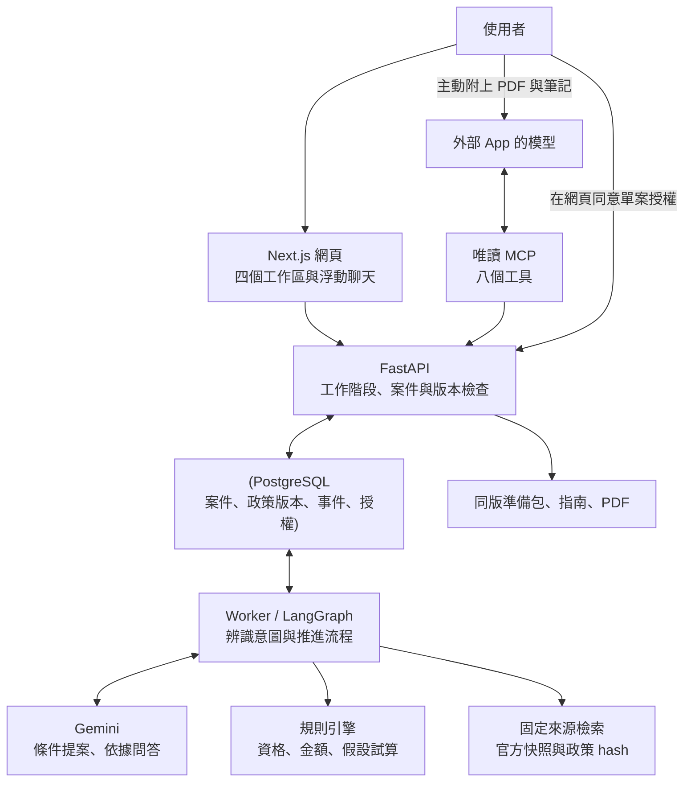

# GovAid 架構

## 分工

| 部分 | 責任 |
| --- | --- |
| 網頁 | 整理條件、確認提案、定位欄位錯誤、比較結果、管理資料包。 |
| Gemini | 理解更正敘述、提出欄位、用本案來源解釋結果；不決定補助金額。 |
| 規則與流程 | 驗證條件、算金額、分開假設與正式更正、保留版本和操作事件。 |
| PostgreSQL | 儲存案件與政策，不把瀏覽器人物暱稱當成帳號驗證。 |
| 來源檢索 | 搜尋固定版本的政策資料，保留來源與 hash；不是即時上網查詢或向量資料庫。 |
| PDF | 與準備包、指南共用內容。改過案件後須重新下載。 |
| MCP | 每案授權後唯讀取得資料。外部 App 可將案件、PDF 與個人筆記放在一起複核。 |

## 一次更正怎麼走

使用者描述更正 → Gemini 提案 → 使用者核對欄位 → 儲存 → 規則重新試算 → 核對準備包 → 下載同版 PDF → 外部 App 經 MCP 複核。

直接填表不呼叫 Gemini。網頁先檢查日期與數值格式；填完資料後，在「最後核對」確認相關條件，再儲存。後端仍依契約檢查資料，不依賴前端驗證。缺項由規則列出，可連續填寫後再儲存；聊天提案尚未儲存時，介面保留原值與新值。

假設問題另走規則試算，不直接寫入正式條件。訊息、條件與政策各有版本邊界；外部 App 必須先讀最新 revision，再取得同版資料，不能以舊文件冒充新結果。

## 容器

三個應用映像：API（同時供 Worker／遷移／匯入使用）、Web、MCP；另用 PostgreSQL。MCP 與 API 共用容器網路，只取得本機 API／Web 位址，不接收模型 key、Docker socket 或主機檔案掛載。預設 Web／API 只綁定主機的 127.0.0.1。選用手機模式時，Web 額外綁定指定 Wi-Fi IP，API 主機埠維持本機限制，但 Web 代理仍提供 API 操作。

區網入口使用 HTTP，只供可信任 Wi-Fi 的合成資料體驗。IP 不作驗證；連線者可建立自己的匿名案件，聊天可能消耗模型配額。測後移除區網綁定並停用防火牆規則，操作見 [手機教學](mobile.md)。正式對外服務還需 HTTPS、身分驗證與用量限制。

目前是本機展示系統，支援四方案的一般案件。憑證失效時，舊案清單保留；重試不會恢復權限。匿名工作階段不是完整登入系統；沒有官方送件串接，也不保證特殊資格或跨方案併領。mock 提供不連接雲端模型的操作方式；使用自然語言問答時，請啟用 Gemini。
